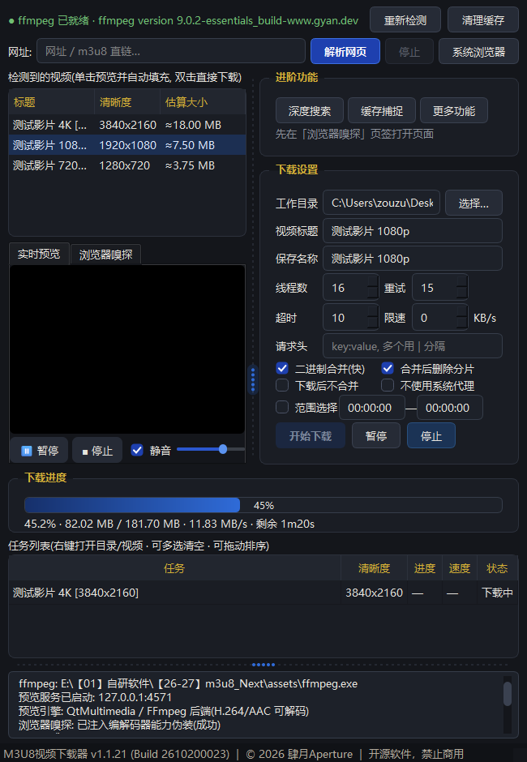
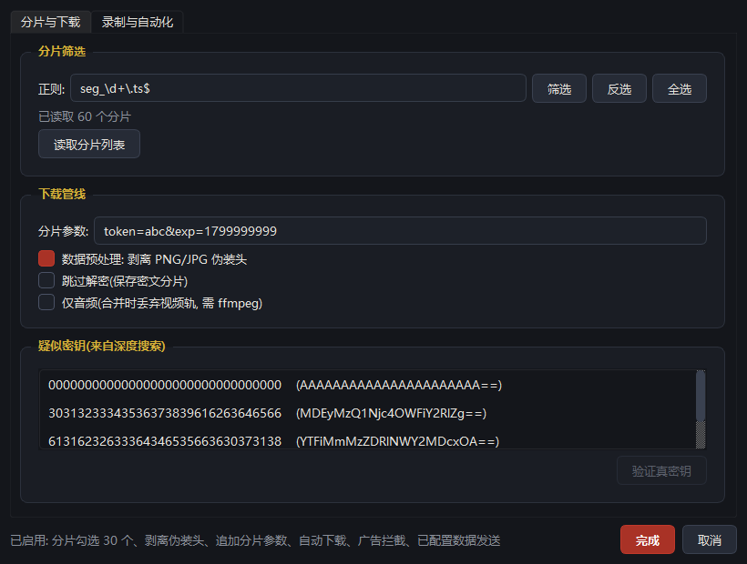
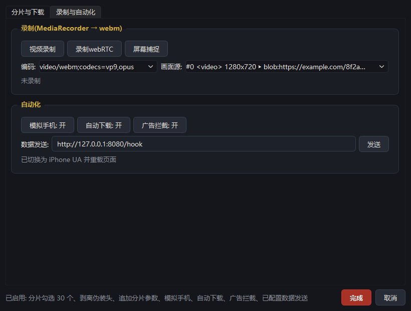
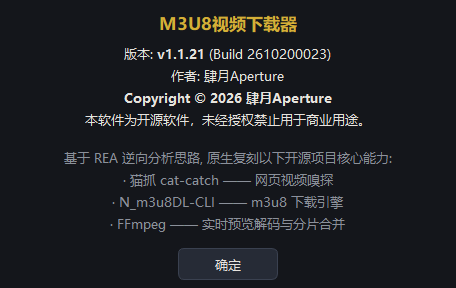
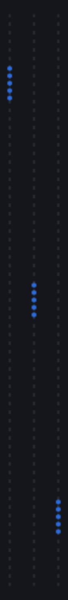

<div align="center">

# 🎬 M3U8视频下载器 (M3U8 Video Downloader)

**网页视频嗅探 · m3u8 / mp4 直链下载 · 内置预览 · B站 DASH 合并 · 单文件 exe**

**把网页里播得出来的东西，原样落到硬盘上** · *If it plays, it downloads.*

-c0392b?style=flat-square)


-41cd52?style=flat-square\&logo=qt)


</div>

---

## ✨ 它是什么

一个 **Windows 桌面端 m3u8 视频下载工具**。基于 **REA（Reverse Engineer Anything）行为级逆向**思路，对下面两个开源项目做能力复刻，用 Python + PySide6 原生重写：

| 参考项目 | 复刻内容 |
| --- | --- |
| [猫抓 cat-catch](https://github.com/xifangczy/cat-catch) | **网页嗅探**：网址 → 自动识别页面内 m3u8 / mp4 直链，展开 master 多码率变体；外加它的三大杀招 —— **深度搜索**（内存钩子捞地址/清单/密钥）、**缓存捕捉**（`appendBuffer` 代理拿已解密裸字节）、**更多功能**（分片筛选 / 伪装剥离 / 密钥验证 / 录制） |
| [N_m3u8DL-CLI](https://github.com/nilaoda/N_m3u8DL-CLI) | **下载引擎**：并发分片、AES-128 解密、二进制 / ffmpeg 双合并、范围选择、限速、直播录制 |

- **真的能下下来**：不是"丢个链接给 ffmpeg"。403 防盗链、请求头集合指纹、占位流（taunt/promo）、token 过期、跨域 iframe、无 H.264 解码器 —— 这些拦路的坑都是逐条实测凿开的，处理策略写进了代码注释。
- **单文件 exe**：`--onefile --windowed`，内置 `ffmpeg.exe`，双击即用，不需要装 Python、不需要外部浏览器。
- **内置预览**：走 QtMultimedia 的 FFmpeg 后端（`QMediaPlayer`），自带 H.264 / AAC 解码，选中即播，支持直播。

> Copyright 2026 肆月Aperture · 本软件为开源软件，未经授权禁止用于商业用途。

---

## 📸 界面一览

<p align="center">
  
</p>

启动动效（自绘半透明卡片，1.5 秒三段：图标放大淡入 → 标题与版本 → 进度扫动后放大淡出，视觉上"化进"主窗口）：

<p align="center">
  
</p>

「更多功能」双页签（对应猫抓的分片后处理 + 按钮条）：

| 分片与下载 | 录制与自动化 |
| --- | --- |
|  |  |

「关于」对话框（三段式，实测高度 288px）与分栏五点把手的三档位置：

| 关于 | 五点位置 |
| --- | --- |
|  |  |

---

## 🚀 下载与运行

**无需安装 Python、无需外部浏览器、ffmpeg 已内置。**

1. 到 [Releases](../../releases) 下载 `M3U8视频下载器_v1.1.21.exe`（约 **218 MB**，单文件）。
2. 双击运行 —— 首次启动会自检 `ffmpeg.exe`，顶部状态条显示 **`ffmpeg 已就绪 · ffmpeg version 9.0.2`**。
3. 没有运行期数据库，不写注册表；设置存 `%APPDATA%/m3u8dl/settings.json`，日志写 `%TEMP%/m3u8dl_crash.log`。

> ⚠️ 因为是 PyInstaller 单文件 exe（内部含 QtWebEngine + ffmpeg），部分杀软会误报。源码完全开放，可自行核对或从源码构建。
>
> ℹ️ 体积说明：v1.1.21 对打包做了体积裁剪，**287 MB → 218 MB（−69 MB）**，见「核心功能深挖 · 8️⃣」。

---

## 🖱️ 怎么用

- **最简单的一条路**：把网页地址粘进顶部网址栏 → 点「解析网页」→ 列表出现条目 → 双击下载。
  - 静态页面直接正则抓；抓不到就自动回退**内置 Chromium** 真实加载页面并拦截网络请求，页面出现在「浏览器嗅探」页签，**点一下播放**即可逼出延迟加载的视频请求。
- **只下 m3u8 直链**：直接粘进网址栏也认，会展开 master 的全部码率变体。
- **B站**：粘 `bilibili.com/video/BVxxx`（或 `b23.tv` 短链、`av` 号、多P 的 `?p=2`）→ 解析结果按画质从高到低列出。下载时**音视频两条 DASH 流分别下完再自动 `ffmpeg -c copy` 合成 mp4**，不会得到无声成片。
- **网站把地址藏在 JS 内存里**（不发请求）→ 点「**深度搜索**」：在页面里挂钩 12 处"把东西算出来"的函数，捞 m3u8 原文与密钥，捞到的清单可直接下载、可预览。
- **地址拿到了却下不了、画面解不出来** → 点「**缓存捕捉**」：代理 `MediaSource.appendBuffer`，直接留存播放器送进解码器的**已解密裸字节**，一次绕开 AES / 图片伪装 / 分片 token。
- **需要处理分片** → 「**更多功能**」：分片正则筛选、参数追加、图片伪装剥离、跳过解密、仅音频、疑似密钥一键验证；第二页签是录制 / webRTC / 屏幕捕捉 / 模拟手机 / 自动下载 / 数据发送。
- **内置引擎里页面永远不发视频请求**（跨域 iframe + 无 H.264 解码器）→ 点「**系统浏览器**」：改用本机 Edge / Chrome 打开页面，通过调试协议**只听不发**，拿到真浏览器发出的请求连同真实 Referer / Cookie 一起回放。在弹窗里点播放，再按一次结束即自动解析。
- **多任务**：任务表右键可打开所在目录 / 打开视频文件 / 删除任务 / 删除文件；可多选清空、可拖动排序；队列静默后台下载。

---

## 🎨 界面上的几处讲究

这些细节是观感与稳定性的来源，单独拎出来说明。

### ① 无菜单栏：版本信息在状态栏，点它弹「关于」

删掉了「文件 / 工具 / 帮助」整条菜单栏，底部状态栏写 `M3U8视频下载器 v1.1.21 (Build 2610200023) | © 2026 肆月Aperture | 开源软件，禁止商用`，点这段文字弹出「关于」。

关于框是**三段式**（标题 / 正文 / 致谢各一个 `QLabel`），高度不写死、在 `showEvent` 里按实测 `sizeHint` 固定 —— **不能在构造期算**：此刻 QSS 还没 polish，量到的是默认字号的 hint。17px 粗体的标题行还要单独收一次：`QLabel` 给出的行盒是 **45px**（字高才 22px），按 `fontMetrics().height()+4` 收到 26px。实测 **360 → 288px**，宽度 480 → 456。

### ② 表单左边缘是一条竖线，不是锯齿

「下载设置」原来是一堆 `QHBoxLayout` 竖直叠起来，每行标签各按自己字宽占位 —— 「工作目录 / 视频标题 / 保存名称」4 个字（52px），「线程数 / 请求头」3 个字（39px），「超时」2 个字（26px），输入框跟着往左跑（实测 **75 / 62 / 50**）。改成 `QGridLayout`，第 0 列统一成最宽标签宽度，六个输入框实测**全部 x=78**。

同理，四个勾选框改成 **2×2 网格**：第二列不再各按标签宽度起步，`horizontalSpacing` 给 18px，实测 `二进制合并 / 下载后不合并` 都在 x=340、`合并后删除分片 / 不使用系统代理` 都在 x=470。同一列的多行数字框也一样 —— 四个 spinbox 一律 `setFixedWidth(70)`，否则「看起来是一列」的三组控件会各走各的（实测重试框 196 / 限速框 178）。

### ③ 分栏拖动条：五个点能抓，两种手势互不干扰

左右分栏、任务表↔日志之间都是自绘的五点把手（`handleWidth 16`，五点颜色跟主色）。这一簇点不只是装饰：

- **抓在五点上拖** = 只把这簇高亮沿虚线滑到新位置（0~1 按虚线可用长度换算），左右列宽 / 上下行高**一点都不动**；
- **抓在五点以外拖** = 原生行为，照旧调宽高；
- 靠**命中区**区分：簇中心 ±16px 内算抓点（把手只有 16px 宽、簇本身才 30px 长，命中区给足才按得住）；
- 鼠标停在簇上换成四向光标并浮出一层淡蓝胶囊底，拖动时点径 2.4→2.9、光标变抓手 —— 否则没人知道那几个点能抓。

位置存 `ui/grip_lr` / `ui/grip_tb`，**只在 `closeEvent` 落盘**：分栏比例同理，接 `splitterMoved` 会把"还没拖过"的中间值写盘（窗口每次缩放都触发）。

### ④ 启动动效不能用 `QSplashScreen`

`QSplashScreen` 只能贴静态图，背景还不透明 —— 圆角卡片外围会露出方块。改成自绘 `Qt.SplashScreen | FramelessWindowHint` + `WA_TranslucentBackground`，1.5 秒三段动画；主窗口在最后一帧以 `windowOpacity 0→1`（280ms OutCubic）淡入，两段首尾相接不闪白，点卡片 / 按 Esc 可跳过。卡片先 `show()` 再同步构造主窗口（要拉起预览服务与 WebView，几百毫秒），用户一启动就有反馈。

顺带记一条：`QPainter.setOpacity` 会把值夹到 `[0,1]`，不能"读出再乘再除"，每段各自算 `alpha * k`。

### ⑤ 勾选框必须自绘，否则只剩一个色块

给 `QCheckBox::indicator` 设了 `background-color` / `border-radius` 之后，Qt **不再绘制系统对勾** —— 选中态只剩一个纯色方块，勾没勾只能靠颜色猜。所以 `_TickBox` 在 `paintEvent` 里自己画圆角矩形 + 两笔白线组成对勾；悬停时底色提亮，文字照常由 Qt 画在右侧。

### ⑥ 窄而高：默认 650×940

贴边放不挡桌面。网址栏做成**顶部通栏**（嵌在列里时地址稍长开头的 `h` 就被滚出可视区，用户看到 `ttps://…`）；左列宽度压到最窄，多出的宽度**全部给右列**，右列表单加 **430 上限**（表单拉宽只会变成跑道）。视频列表在窄窗下按可视宽度收起「码率」(<430) 与「时长」(<320) 列，把宽度让给标题，窗口拉宽自动恢复 —— 收起的数据仍在条目 tooltip 里。

---

## 🔍 核心功能深挖

### 1️⃣ 嗅探：三套引擎逐级兜底

| 引擎 | 干什么 | 什么时候用 |
| --- | --- | --- |
| **静态嗅探** | 抓 HTML 正则找 m3u8/mp4/flv（兼容 JSON 转义地址），识别无扩展名的清单地址并按可信度排序 | 永远第一个跑，最快 |
| **内置 Chromium 拦截** | `QWebEngineProfile` 上挂请求拦截器，真实加载页面，命中媒体特征即收集 | 静态为空时自动回退 |
| **系统浏览器（CDP）** | `--remote-debugging-port` 拉起本机 Edge/Chrome，`QWebSocket` 订阅 `Network.requestWillBeSent`，只听不发 | 内置引擎有天然局限时手动触发 |

**编解码器能力伪装（内置引擎的救命补丁）**：PySide6 的 QtWebEngine 是**开源编译版，不含 H.264/AAC 专有编解码器** —— 实测 `MediaSource.isTypeSupported('avc1')` 与 `('mp4a')` 全是 `false`、`canPlayType(mpegurl)` 为空。站点播放器在 hls.js `isSupported()` 阶段就放弃，**连 m3u8 都不请求**，现象就是页面报 `Error Code: 102630` 且嗅探为 0。解法是在 `DocumentCreation` + `MainWorld` 注入脚本，在页面脚本执行前把 avc1/mp4a 报告为"支持"，播放器因此正常发起清单请求；同时钩住 XHR / fetch / video.src，把地址收进页面上下文（相对路径必须 `new URL` 解析）。**页面内的视频仍然播不了，属引擎限制**，但嗅探与下载完全不受影响。

**CDP 的两个必踩坑**：① 跨域 iframe 在 Chromium 里是独立 **OOPIF target**，它的请求**不走顶层 session** —— 只听顶层永远是 0 条，必须 `Target.setAutoAttach{flatten:true}` 并按 `sessionId` 分流；② `preload="none"` 仍需起播，且要在**每个 session 的每个 executionContext** 里各跑一次（`Runtime.enable` 才下发 `executionContextCreated`，还要跳过 `auxData.isDefault=false` 的扩展隔离世界）。

### 2️⃣ 请求头：五档回退 + 头集合指纹

CDN 对 `Referer + Origin + UA + Cookie` 做组合校验，纯脚本请求（只有 UA）必被拒。但站点之间的要求**互相矛盾**：

- `streambucket` 类必须回放**宿主页** Referer；
- `uqload` 类必须用**播放器自身域** —— 带宿主页就被 302 到占位流；
- 还有站点带任何 Referer 都拒。

更反直觉的是，有的 CDN 做**请求头集合指纹**校验：`UA + Referer + Origin` → 200，**只多一个 `Accept-Language` → 403**（与值无关，`zh-CN` / `en-US` 全拒），而 `Accept` / `sec-ch-ua*` / `Accept-Encoding(br,zstd)` / `Connection` 都无害。

所以 `reqhdr.py` 按 `captured（浏览器原样）→ minimal（只留 UA/Referer/Origin/鉴权头）→ site_root → no_referer → page` **五档依次试探**，命中即把**实测可用的那套头**交给下载与预览。三条铁律：

1. **捕获头存在时它就是唯一来源**，默认头只补 UA（否则我们自己塞进去的 `Accept-Language` 会让每一档都 403）；
2. `requests` 会把 `session.headers` 与传入头**合并**，脏头藏在 session 上时连精简档也救不回 → 构造 session 只放 UA，进门前先删噪声头；
3. `session.headers.update()` **删不掉**同名旧键 → 必须 `clear()` 后整体替换，否则清单能取、分片照样 403。

此外该 CDN 还有**概率性 TLS 断连**（`SSL: UNEXPECTED_EOF_WHILE_READING`，实测 8 次里 1~2 次），与请求头无关 —— `reqhdr` 与预览代理的分片请求都要原地重试（FFmpeg 逐片拉取，任一片被 403 就花屏）。**单次探测结果不可信，取证必须 5 轮重复。**

### 3️⃣ 占位流（taunt / promo）：那条误导性报错的真凶

部分网盘型源站在**未获授权**（缺 Cookie / token 过期 / Referer 不符）时**不返 403**，而是 302 到 `taunt/promo/master.m3u8`。该清单是**合法 m3u8**，还带 `RESOLUTION=1280x720` 这种顶行横幅，变体又是**相对地址、与请求同名**（`index.m3u8`）—— 用请求前地址做 base 就会解析回**原地址本身**，master → 变体 → master 无限套娃，最后抛出的却是"无法解析 m3u8 播放列表"。

**铁律**：`parse_m3u8` 的 base 必须用 `response.url`（重定向后的**最终地址**），`sniffer` / `downloader` / `preview` 三处都要。同时 `playlist.is_placeholder_url()`（`/taunt/`、`/promo/`、`/placeholder/`，`production` 这类合法词不误判）在嗅探阶段就丢弃占位流，不再伪造假条目；下载器多层展开（≤6 层）+ 已请求地址集合做循环保护，并区分三种失败给可执行建议。

### 4️⃣ 猫抓的三大杀招

普通嗅探只看"请求了哪个 URL"。当站点把地址、清单、密钥全在 JS 内存里算完就交给播放器、**从不发请求**时，网络层永远是空的。下面三项分别从**内存**、**解码器入口**、**下载管线**三个位置补齐缺口：

**深度搜索 —— 盯内存，不盯网络。** 移植 12 个钩子：`JSON.parse` / `XHR` / `fetch` / `TextDecoder.decode` / `btoa`·`atob` / `String.fromCharCode` / `DataView` / 6 种 TypedArray 构造 / `Array.join`·`slice` / `String.indexOf('#EXTM3U')` / `Worker` 自注入 / `<script>` 源码扫描，从数据流里捞地址、m3u8 原文与 16 字节 AES KEY。捞到的清单随任务下发，**下载器完全不请求那个地址**（它往往根本不存在）；预览时挂到本地 `/mem/<token>.m3u8` 再经代理播放。

> 钩子本身要三防：① **自噬** —— 替换 `Array.join` / `String.indexOf` 后，钩子内部判定必须走保存的原生引用；② **`.toString` 覆写自引用爆栈** —— 必须 `Function.prototype.toString.call(orig)` + `defineProperty`；③ **注入顺序** —— 脚本改自包含（开头把正文写进 `window.__M3U8DL_DEEP_SRC`），并整段包 `try/catch` 以便在 Worker 内降级。

**缓存捕捉 —— 代理解码器入口。** 代理 `MediaSource.prototype.addSourceBuffer` 与其 `appendBuffer`，留存播放器送进解码器的**已解密裸字节**，一次性绕开 AES-128、图片/自定义包装伪装、分片级防盗链 token；音视频分离的多路流自动用 `ffmpeg -c copy` 合成。两条硬性要求：先**拷贝再 `appendBuffer`**（引擎会因编解码器不匹配拒收，抛异常就丢字节）；开源引擎建不了 avc1 的 SourceBuffer 时，catch 后用 WebM 的 mimeType 重建 —— 播放废了，但字节仍能完整捕获。

**更多功能 —— 分片级后处理。** 分片正则筛选/反选、分片参数追加（`tsAddArg`，破分片级 token）、图片伪装剥离（PNG `IEND` / JPG `EOI` 定位后切载荷）、跳过解密、仅音频（`-vn` → `.m4a`）、**疑似密钥一键验证**（拿候选 KEY 解首个分片，看结果是否以 `ftyp`/`styp`/`moof`/EBML/ID3/TS 同步字节开头）。

**页面 → Python 传二进制走 QWebChannel**：自定义 scheme `m3u8dl://` 在页面内的 `fetch`/`XHR` 会被 Chromium 协议白名单拒绝（只允许 `chrome`/`chrome-extension`/`chrome-untrusted`/`data`/`http`/`https`），本地 http 受混合内容 / PNA 限制。QWebChannel **不支持 `ArrayBuffer`**（传过去变空 dict `{}`），二进制必须 base64（+33%），页面侧手写编码循环避免 `String.fromCharCode(...arr)` 栈溢出。

### 5️⃣ 录制与自动化（复刻猫抓按钮条）

- **视频录制**：`<video>/<audio>.captureStream(fps)` → `MediaRecorder` → 分片经 QWebChannel 每秒回传 → 顺序 append 落盘 `.webm`。录制是**单条连续流**，不能按 (mime,索引) 分桶，更不能丢前导字节（WebM 的 EBML 头只在最前面，丢了整段报废），故单独开 `rec` 槽。
- **录制 webRTC**：`Proxy` 代理 `RTCPeerConnection`，在 `track` 事件里收 `MediaStreamTrack`（只留最近 4 条防泄漏），凑齐音视频后建 `MediaStream` 录制；`toString` 伪装成 native code。
- **屏幕捕捉**：`getDisplayMedia` + Qt 的 `desktopMediaRequested` 信号，自动选中首个屏幕完成授权。
- **编码协商**：按 `MediaRecorder.isTypeSupported` 遍历 7 种候选 —— 实测开源版 QtWebEngine **支持 7 种（VP8/VP9/Opus）、H.264/AAC 全部 false**，所以输出只能是 webm。
- **模拟手机**（UA 切 iPhone 重载）/ **自动下载**（解析后自动把最高码率那条入队，同一批结果只触发一次）/ **数据发送**（把捕获结果连同请求头 POST 到外部服务）。
- 限制：`captureStream` 只能录**已在解码**的内容。页面内 H.264 视频在本引擎录不到画面 —— 此能力适用于 canvas / VP8·VP9 / WebRTC 场景；H.264 直播请用「缓存捕捉」或直接下 m3u8。

### 6️⃣ 下载引擎：不只认 m3u8

- 并发分片（线程数可调，默认 16）+ 失败重试（默认 15 次）+ 超时控制 + KB/s 限速
- **AES-128-CBC 自动解密**（IV 取 `EXT-X-KEY` 属性或分片序号）
- **fMP4**（`EXT-X-MAP` init 分片）支持：init + 分片二进制拼接直接输出 MP4
- 二进制合并（TS/fMP4 直出，快）或 ffmpeg 合并（remux MP4）；合并后可自动删分片
- 范围选择（按 `HH:MM:SS` 时间段）、直播流滚动窗口边下边存
- **mp4 直链下载**：有的源站只给 `.mp4` 不给 m3u8。`bytes=0-0` 探 1 字节拿总大小与 `Accept-Ranges` → 自适应块大小切 Range 并发（**上限 6 路**，实测 16 路跑到 78% 时整片 503）→ 按偏移写同一 `.part` → 503/429 指数退避
- **mp4 元数据从 `moov` box 读**：`mvhd` 给时长 + timescale，`tkhd` 末尾 8 字节是 16.16 定点宽高；`moov` 在头（faststart）或尾都能找（头 256KB、尾 2MB 各试一次，约 0.3% 开销）
- **B站 DASH 双流**：`video.m4s` + `audio.m4s` 两条独立流按 Range 分别下完，再 `ffmpeg -c copy`（不重编码）合成 mp4，进度按两条流字节总和计算不跳变。风控方面裸 `requests` 请求 `api.bilibili.com` 直接吃 **412**（返回 HTML 拦截页），需先 `/x/frontend/finger/spi` 拿 `buvid3`/`buvid4` 并自补 `_uuid`，再带 `Referer`/`Origin`/`Accept` 访问；CDN 只认 `https://www.bilibili.com/` 作 Referer。画质上限取决于登录态（未登录通常 480P，在「浏览器嗅探」页签里登录过 B站 可解锁 1080P+）

### 7️⃣ 预览：QMediaPlayer（FFmpeg 后端）

不能走 QtWebEngine —— 它没有 H.264 解码器。改设 `QT_MEDIA_BACKEND=ffmpeg`（须在 `QApplication` 之前），经**本地 HTTP 代理**播放（自动代填 Referer / Cookie / UA，并重写 m3u8 内的分片地址）。两条坑：

- **代理路径必须保留原文件名** `/p/<name>?u=...`，否则 FFmpeg 的 HLS 解复用器报 `allowed_segment_extensions`；
- **本地 m3u8 文件播不了**：输入是本地文件时，HLS 解复用器协议白名单只有 `file,crypto,data`，拉 http 分片直接报 `Protocol 'http' not on whitelist` —— 内存里的清单必须先挂到本地 http 才能播。

`QVideoWidget` 无媒体时**不画背景**（直接放会露出灰色窗口底，观感像空面板），所以用黑底 `QFrame#pvBox` + `QStackedLayout` 叠一个居中提示页，加载时切页。

### 8️⃣ 单文件 exe 与体积裁剪（v1.1.21）

PyInstaller onefile。`287 MB → 218 MB` 的关键不是 UPX，而是**打包方式从命令行改成 spec**：命令行参数只能在"收哪些"上做加法、收不回来，而 onefile 包里真正的大头是**用不到的 Qt 资源**，只能靠 Analysis 之后过滤 TOC。

| 内容 | 原体积 | 处理 |
| --- | --- | --- |
| `PySide6/resources/*.debug.pak` `*.debug.bin` | 78 MB | 删（DevTools 符号资源，运行期不用） |
| `PySide6/translations/*.qm`（305 个语种） | 57 MB | 只留 `*_zh_CN.qm`（13 个） |
| `PySide6/qml/**`（2515 个文件） | 24 MB | 删（WebEngine 走 C++ / Widgets 侧，不用 QML） |
| 用不到的 Qt 模块（Qt3D / Pdf / Designer / Graphs / Charts…） | ~45 MB | 不再 `--collect-submodules PySide6` |
| 用不到的插件（sqldrivers / designer / canbus / qmltooling…） | ~10 MB | 按白名单过滤 |

`--collect-submodules PySide6` 是体积元凶：它会把 PySide6 里全部子模块连同 DLL、QML、翻译一起收进来，而项目实际只用 9 个（QtCore / Gui / Widgets / WebEngineCore / WebEngineWidgets / Multimedia / MultimediaWidgets / WebSockets / WebChannel）。实测 TOC 条目 **2998 → 239**，裁剪后的包体三大件是 `QtWebEngineCore 194.5MB` / `ffmpeg.exe 100.5MB` / `resources 24.2MB`。

裁剪不伤功能，靠三个自检在**打包后的 exe** 上验证：`--selftest-media`（生成 H.264 HLS 并解码）、`--selftest-adv`（QWebChannel 资源 + 三个功能的注入脚本，24/24）、`--selftest-rec`（录制链路，EBML 头 + 7 种编码协商）。

### 9️⃣ 广告拦截：EasyList 级

双层实现：① 网络层在拦截器里对广告/统计域名与路径特征 `info.block(True)`，请求不出网；② 元素层注入 CSS 隐藏广告位 + `MutationObserver` 清理动态插入的广告 iframe。规则源是 **EasyList + EasyList China** 全量（57,849 个域名，`adlist.py` 自动生成），匹配用**逐级剥标签查哈希表**（3 次查表，与规则量无关），`@@` 例外与 CDN 白名单必须排除。

**铁律**：**视频地址与主框架导航永不拦截**，且判断顺序必须是"先判视频特征并收集 → 再判广告"—— 广告联盟也会下发 m3u8，拦掉就少候选；贴片 mp4 这类边界情况留给用户判断。

### 🔟 工程化：进程管理与诊断

- **启动清理残留**：单实例管理，启动时自动干掉之前未关闭的进程。PyInstaller 6.x onefile 是 **bootloader 父进程 + 应用子进程（同 exe 路径）**，清理必须跳过 `os.getpid()` 与 `os.getppid()`，否则误杀父进程。
- **退出不弹框**：`closeEvent → app.exec() 返回 → terminate_children（杀 QtWebEngineProcess 等）→ force_exit`。windowed 模式下 `sys.stdout` / `sys.stderr` **都是 `None`**，任何 `print` / `flush` 都会抛 `AttributeError`，被 bootloader 拦截弹出 "Unhandled exception in script" 模态框阻塞退出 —— 所有输出必须判空容错。
- **不闪黑框**：打成 `--noconsole` 之后任何外部命令都会闪一下控制台（启动第一件事就是 `ffmpeg -version`）。`fftools.run_hidden()` 统一加 `CREATE_NO_WINDOW`（`0x08000000`），覆盖 ffmpeg 探测/合并/mux/自检与 CDP 拉起浏览器。
- **诊断**：`sys.excepthook` + 里程碑日志写 `%TEMP%/m3u8dl_crash.log`。

---

## 📦 版本命名与迭代记录

**外部版本号** `vX.Y.Z`：第二位 `MINOR` = 大版本迭代（功能新增）；第三位 `PATCH` = 小版本迭代（bug / 小改进）。
**内部构建号** `YYMMDDNNNN`：日期段取当天，末四位当日迭代序号（示例 `2610200001` = 2026-10-20 当日第 1 次构建）。

| 版本 | 构建号 | 日期 | 类型 | 主要变更 |
| --- | --- | --- | --- | --- |
| v1.1.21 | 2610200023 | 2026-10-20 | 精简 | 打包改 **spec 方式**并按 TOC 过滤：删 `.debug.pak`(78MB)、translations 只留 zh_CN(57MB→)、删 `qml/**`(24MB)、去 `--collect-submodules PySide6`(~45MB)、插件白名单 —— **287.3MB → 218.2MB（−69MB）**，TOC 条目 2998→239；三个自检在裁剪后的 exe 上全过。vulture + AST 扫出并删除 6 处死代码与 7 处未用 import；清理工程目录缓存与临时文件；README 按流明盒模板重写 |
| v1.1.20 | 2610200022 | 2026-10-20 | 反馈 | **分栏五点可抓**：抓在簇上拖 = 只把高亮沿虚线滑到新位置（不碰宽高），抓在簇外拖 = 原生调宽高；簇中心 ±16px 命中区区分两种手势；悬停换四向光标并浮淡蓝胶囊底、拖动时点径 2.4→2.9。位置存 `ui/grip_lr` / `ui/grip_tb`，只在 `closeEvent` 落盘。新增 `tests/probe_grip.py` 10/10 |
| v1.1.19 | 2610200021 | 2026-10-20 | 反馈 | **关于框压高** 360→288px（三段式 + 行高 1.8→1.3 + 标题行盒 45→26px，高度改在 `showEvent` 按实测 `sizeHint` 定）；**勾选框改 2×2 网格**，第二列同 x、间隙 18px。新增 `tests/probe_about.py` 7/7 |
| v1.1.18 | 2610200020 | 2026-10-20 | 功能 | **全量换图标**（按 alpha bbox 裁紧 + 逐步减半锐化 → 七档 ICO）；**消除 subprocess 黑框**（`run_hidden` + `CREATE_NO_WINDOW`）；**启动动效**（自绘半透明卡片，1.5s 三段 + 主窗口 280ms 淡入）。顺手修 `assets_dir()` frozen 分支找不到 `_MEIPASS/assets/` 的老 bug |
| v1.1.17 | 2610200019 | 2026-10-20 | 反馈 | 三个数字框归列（四个 spinbox 一律 70 宽）；子布局塞进 `QGridLayout` 时 `spacing` 退化成 0 → 三按钮间隙 0→8px；`#advBtn` 内边距 `6px 8px`→`6px 15px`，与「开始下载」文字起始位对齐 |
| v1.1.16 | 2610200018 | 2026-10-20 | 反馈 | 表单改 `QGridLayout`（六个输入框全部 x=78）；`progGroup` 覆盖 padding（框高 95→77px）；任务表/日志之间加竖向五点拖动条，默认真 1:1 等分（`setSizes([1,1])` 会把最小高度算进权重）；窗口最小高度 938→841px |
| v1.1.15 | 2610200017 | 2026-10-20 | 反馈 | 配色收口：`#pvBox` 去描边（真凶是容器的 border，不是按钮）、静音并入深蓝、音量条 紫→蓝、五点 鎏金→深蓝。新增 `tests/probe_v115_colors.py` **截图逐像素采样** 11/11 |
| v1.1.14 | 2610200016 | 2026-10-20 | 功能 | **B站支持**（DASH 双流 + 412 风控 Cookie 引导 + avc1 编码择优 + 自动 `-c copy` 合并）；整体配色 朱红→深蓝；`_TickBox` 自绘白勾；「进阶功能」加框；左右列底边对齐。新增 `tests/test_bili.py` 61 项 |
| v1.1.13 | 2610200015 | 2026-10-20 | 反馈 | 进阶三件套移到右列顶部（不与"内容"抢地方）；预览控制条改浅灰圆角 + 圆形静音 + 紫色音量条（`_TickBox` 自绘的原因）；为装进 650×940 去掉 `SPINBOX` suffix 等四处压缩 |
| v1.1.12 | 2610200014 | 2026-10-20 | 反馈 | 网址栏上移**通栏**（嵌在列里时开头 `h` 被滚出可视区）；下载进度下移到任务表上侧，只报整文件进度（新增 `bytes_total`）；默认窗口 650×900、右列 430 上限；列表按宽度收起码率/时长列 |
| v1.1.11 | 2610200013 | 2026-10-20 | 功能 | **系统浏览器嗅探（CDP）** + **mp4 直链下载**（`bytes=0-0` 探测 + Range 自适应分块，并发上限 6）+ **`mp4info.py`**（从 `moov` 读时长/宽高/码率）+ **EasyList 全量拦截**（5.7 万域名）；注入脚本改 `runsOnSubFrames=True` 并加 `pokePlay()`，跨域 iframe 捕获 0→1 |
| v1.1.10 | 2610200012 | 2026-10-20 | 修复 | **请求头集合指纹根因**：多带一个 `Accept-Language` 就 403（与值无关）。捕获头存在即唯一来源、session 只放 UA、`headers.update()` 删不掉旧键须 `clear()` 后整体替换；新增 `minimal` 档，策略变五档 |
| v1.1.9 | 2610200011 | 2026-10-20 | 修复 | **uqload 型 Referer 必须是自身域**：`firstPartyUrl()` 拿到的是宿主页，无条件覆盖捕获 Referer → 被 302 到占位流。改为捕获优先、`firstPartyUrl` 只兜底；新增 `reqhdr.py` 四档回退 + 瞬断重试；**内置广告拦截**（网络层 block + 元素层 CSS）。新增 `test_referer.py` 19 项 / `test_adblock.py` 31 项 |
| v1.1.8 | 2610200010 | 2026-10-20 | 功能 | 「更多功能」补全猫抓按钮条 **6 个按钮**（视频录制 / webRTC / 屏幕捕捉 / 模拟手机 / 自动下载 / 数据发送），改双页签；左列宽度压缩真凶是右列 `setMaximumWidth(620)`，解除后 617→370px |
| v1.1.7 | 2610200009 | 2026-10-20 | 修复 | **master → 变体 → master 死循环**：占位清单变体是相对地址且与请求同名，用请求前地址做 base 就套娃。三处改用 `response.url` 做 base；新增 `is_placeholder_url()` 嗅探阶段丢弃；下载器多层展开 + 循环保护。新增 `test_placeholder.py` 17 项 |
| v1.1.6 | 2610200008 | 2026-10-20 | 功能 | **补齐猫抓三大杀招**：深度搜索（12 个内存钩子）、缓存捕捉（`appendBuffer` 代理）、更多功能（分片筛选/伪装剥离/密钥验证）。内存清单可下载可预览（`/mem/<token>.m3u8`）；传输通道选型闭环 → QWebChannel + base64 |
| v1.1.5 | 2610200007 | 2026-10-20 | 修复 | **403 防盗链**：嗅探早已拿到地址，但解析请求只有 UA。新增 `cookies.py`（监听 `cookieStore` 自建罐）+ 拦截器记录真实请求头 + 三级头回退；任务表右键增删除任务/删除文件；删除菜单栏，版本信息移状态栏 |
| v1.1.4 | 2610200006 | 2026-10-20 | 功能 | **定位 `Error 102630` 根因**（开源 QtWebEngine 无 H.264/AAC）→ 新增 `webinject.py` 编解码器伪装 + URL 钩子；**预览引擎换 `QMediaPlayer`（FFmpeg 后端）**；代理分片路径保留原文件名；界面重构为左列/右列/底部通栏 |
| v1.1.3 | 2610200005 | 2026-10-20 | 修复 | UA 里含 `QtWebEngine/6.11.2` 标识被站点识别 → 移除标识伪装成普通 Chrome，并启用 `--autoplay-policy=no-user-gesture-required` |
| v1.1.3 | 2610200004 | 2026-10-20 | 功能 | 任务表右键（打开目录/打开文件）、多选清空（跳过下载中）、拖动重排序、清理网站缓存（保留 Cookie）；下载完成记录 `out_path`。新增 `test_tasktable.py` |
| v1.1.2 | 2610200003 | 2026-10-20 | 功能 | **浏览器引擎嗅探**：拦截器挂 `defaultProfile`，内置 Chromium 真实加载页面并拦截全部请求；静态嗅探空结果时自动回退，沉降 12 秒捕获延迟请求。新增 `test_websniff.py` |
| v1.1.1 | 2610200002 | 2026-10-20 | 修复 | windowed 模式 `sys.stdout`/`sys.stderr` 为 `None`，退出时 `flush()` 抛 `AttributeError` 被 bootloader 弹框阻塞 → 全部判空容错；新增全局 `excepthook` 与退出里程碑日志 |
| v1.1.1 | 2610200001 | 2026-10-20 | 首发 | 网页嗅探（m3u8/mp4/flv、master 多码率、时长/大小估算）、内置预览、m3u8 下载引擎（并发/AES-128/fMP4/双合并/范围/限速/直播）、CLI 风格进度日志、ffmpeg 内置、单实例进程管理、深色主题 UI |

---

## 📁 目录结构

```
m3u8_Next/
├── M3U8视频下载器_v1.1.21.exe      # 单文件可执行（内置 ffmpeg.exe）
├── logo.png / logo.psd              # 品牌源图（900×900）
├── 动画.gif                          # 启动动效演示
├── README.md
├── main.py                          # 入口: 进程清理 -> Qt 应用 -> 退出强制终止
├── build.py                         # 打包脚本（生成 spec + TOC 体积裁剪）
├── requirements.txt
├── m3u8dl/                          # 源码（PySide6）
│   ├── version.py                   # 版本号管理
│   ├── playlist.py                  # m3u8 解析（HLS RFC 8216: master/media/AES-128/fMP4）
│   ├── sniffer.py                   # 静态网页嗅探
│   ├── websniff.py                  # 内置 Chromium 嗅探（请求拦截 + 广告拦截）
│   ├── webinject.py                  # 页面注入（编解码器伪装 + URL 钩子 + 主动起播）
│   ├── cdp.py                       # 系统浏览器嗅探（CDP: OOPIF + 逐 context 起播）
│   ├── adblock.py / adlist.py       # 广告拦截规则 / EasyList 域名表（5.7 万，自动生成）
│   ├── deepsearch.py                # 深度搜索（内存级钩子：地址/清单/密钥）
│   ├── capture.py                   # 缓存捕捉（appendBuffer 代理 + 边收边落盘）
│   ├── recorder.py                  # 录制（MediaRecorder / webRTC / 屏幕捕捉）
│   ├── bridge.py                    # 页面 -> Python 数据桥（QWebChannel + base64）
│   ├── fragtools.py                 # 分片后处理（筛选/伪装剥离/密钥验证）
│   ├── reqhdr.py                    # 请求头策略（五档回退 + 噪声头剥离 + 瞬断重试）
│   ├── downloader.py                # 下载引擎（分片/AES/fMP4/mp4 直链/DASH 双流）
│   ├── mp4info.py                   # mp4 元数据（从 moov box 读时长/宽高/码率）
│   ├── bili.py                      # B站（playurl 接口 + DASH + 风控 Cookie 引导）
│   ├── preview.py                   # 内置预览（本地代理 + 分片重写 + 内存清单挂载）
│   ├── fftools.py                   # ffmpeg 探测与合并（含无黑框封装）
│   ├── procguard.py                 # 进程管理（启动清理 / 退出终止）
│   ├── selftest.py                  # 打包后自检（media / adv / rec）
│   ├── diag.py                      # 诊断日志
│   └── ui/                          # PySide6 深色界面（墨黑 / 深蓝 / 鎏金）
│       ├── main_window.py           # 主窗口（含 _DotsSplitter / _DotsHandle）
│       ├── splash.py                # 启动动效（自绘半透明卡片）
│       ├── tools_dialog.py          # 「更多功能」双页签
│       ├── about.py                 # 「关于」对话框
│       └── theme.py                 # DARK_QSS
├── assets/                          # hls.min.js / ffmpeg.exe / icon.ico / icon.png
├── tests/                           # 单元 / 集成 / 冒烟 / 探针脚本
├── tools/                           # make_icon.py / build_adlist.py
├── docs/shots/                      # 界面截图与放大特写
└── history/                         # 历史版本 exe 留档
```

**下载引擎流程**：解析 m3u8 → master 选最高码率 → 并发下载分片（AES 解密）→ 二进制合并（TS 直出 `.ts` / fMP4 直出 `.mp4`）或 ffmpeg 合并（remux `.mp4`）→ 清理分片。

---

## 🛠️ 开发与打包

### 环境

- Python 3.13 + PySide6（Qt 6）+ PyInstaller 6.x
- `requests`（HTTP）、`cryptography`（AES-128）、`psutil`、`pillow`（图标生成）

```bash
pip install -r requirements.txt
```

### 常用命令

```bash
# 源码态直接跑
python main.py

# 打成单文件 exe（产出 dist/M3U8视频下载器.exe）
python build.py
```

- 打包参数全部写在 `build.py`（生成 `.spec` 再传给 PyInstaller）—— **传 `.spec` 时不能再带 `--onefile` / `--noconsole` / `--icon`**，PyInstaller 会直接报 option not allowed。
- 最新版 exe 放根目录并按 `M3U8视频下载器_vX.Y.Z.exe` 命名，旧版归档到 `history/`。

### 测试（20 套回归 + 冒烟 + 探针）

| 脚本 | 作用 |
| --- | --- |
| `tests/test_core.py` | 单元：playlist 解析 / master 变体 / AES / 文件名清洗 |
| `tests/test_download.py` | 集成：本地 ffmpeg 生成测试流（TS / fMP4 / AES / 范围 / 直播） |
| `tests/test_websniff.py` / `test_webinject.py` / `test_codec_gate.py` | 拦截链路 / 页面注入 / **编解码器门禁对照**（未注入 → 102630 + 零请求；注入后 → 播放 + 捕获） |
| `tests/test_preview_player.py` | 预览经本地代理真实解码计帧 |
| `tests/test_headers_replay.py` / `test_headfinger.py` / `test_referer.py` | 请求头回放 / 「多带一个头就 403」的集合指纹 / Referer 自身域与四档回退 |
| `tests/test_placeholder.py` | 302 占位清单 / 自引用 master / 重定向 base |
| `tests/test_deepsearch.py` / `test_capture.py` / `test_fragtools.py` / `test_adv.py` | 内存钩子（含"网络层 0 请求"对照组）/ appendBuffer 代理 / 伪装剥离与密钥爆破 / 内存清单可下载可预览 |
| `tests/test_direct.py` / `test_cdp.py` / `test_adblock.py` / `test_bili.py` | Range 分块与 503 退避 / OOPIF 自动附加 / EasyList 规则 / B站 61 项 |
| `tests/test_recorder.py` | 录制：EBML 头 / 单流不丢前导字节 / 编码协商 |
| `tests/smoke_ui.py` | UI 冒烟：从 v1.1.12 起的**每一条布局与配色约定**都留了断言（窗口尺寸、表单 x 坐标、五点把手类型、勾选框配色…） |
| `tests/probe_about.py` / `probe_grip.py` / `probe_v115_colors.py` / `probe_splash*.py` | 几何探针 / 五点手势 10 项 / **截图逐像素取色** 11 项 / 启动动效分帧与时序 |
| `tests/smoke_exe.py` | 打 exe 冒烟三项：启动存活 / 单实例清理 / 优雅关闭无残留 |
| `tests/probe_403.py` / `probe_cdp.py` / `probe_uqload.py` / `probe_bili_ui.py` | 真实站点探针（需外网，会启动本机 Edge） |
| `tests/diag_shutdown.py` | 复现优雅关闭诊断 |

打包后自检（结果写 `%TEMP%/m3u8dl_crash.log`）：

```bash
M3U8视频下载器.exe --selftest-media   # QtMultimedia/FFmpeg 解码链路
M3U8视频下载器.exe --selftest-adv     # QWebChannel 资源 + 三个功能的注入脚本（24 项）
M3U8视频下载器.exe --selftest-rec     # 录制链路（EBML 头 + 编码协商）
```

> ⚠️ 交付铁律：验收以**数据断言**取代肉眼截图。凡验「控件是否真画出来 / 颜色对不对」的探针，必须**截图后逐像素取色**并在真机后端跑 —— 离屏与真机结论可差出一个 QStyle，单点取色还会把勾选框中心的白色对勾笔画误判成背景。

### 排障

- **杀软误报**：PyInstaller 单文件 exe 常被误报，源码开放可自行核对或从源码构建。
- **页面里播放器报错 ≠ 抓不到**：`Error 102630` / uqload `232011` 都是开源 QtWebEngine 无 H.264 解码器导致的，页面内永远播不了；此时 m3u8 请求往往已经正常发出（所以能被捕获），下载走 HTTP + FFmpeg，预览走 QMediaPlayer。
- **`Get-Process | MainWindowTitle` 拿不到 exe 版本**：Qt 的隐形窗口（`_q_titlebar`）也会被列出来且不带版本号，判版本要用 EnumWindows 过滤可见窗口。

---

## 📄 版权与声明

```
Copyright © 2026 肆月Aperture
本软件为开源软件，未经授权禁止用于商业用途。
```

本工具仅供下载用户拥有版权或已获授权的视频，请遵守当地法律法规。

第三方组件与参考项目：

- [PySide6](https://doc.qt.io/qtforpython/) (Qt 6, LGPLv3) — 界面
- [FFmpeg](https://ffmpeg.org/) — 解码预览与分片合并（已内置打包）
- [猫抓 cat-catch](https://github.com/xifangczy/cat-catch) (GPL-3.0) — 网页视频嗅探参考
- [N_m3u8DL-CLI](https://github.com/nilaoda/N_m3u8DL-CLI) (MIT) — m3u8 下载引擎参考
- [hls.js](https://github.com/video-dev/hls.js) / [EasyList](https://easylist.to/) / [REA](https://github.com/morluto/rea)

---

## 📮 联系作者

|  |  |
| --- | --- |
| GitHub | <https://github.com/zouzuo1994321> |
| 哔哩哔哩 | <https://space.bilibili.com/13715> |
| 微博 | <https://weibo.com/u/5189652182> |
| 邮箱 | <921103025@qq.com> |
